<!--
  The Art of Getting Lost: profile README for @EnesKaraca44.
  Every image in /assets is a self-contained SVG (lettering is outlined, no external fonts or images),
  so the page looks the same on every device. Animations respect prefers-reduced-motion.
-->

  

  

<h2 align="center"></h2>

I'm Enes, a developer from Türkiye working across three territories: native Android and Flutter apps, backends in ASP.NET Core and Flask, and data science with machine learning. I learn the way travellers do, by heading somewhere unfamiliar and building my way through it. So far that has meant a phone camera that coaches workout form, a live photo wall for weddings, and a graduation thesis that forecasts and optimises BIST&nbsp;30 portfolios.

I take on freelance projects through [Upwork](https://www.upwork.com/freelancers/~0143bae00c47e48a6a), and I'm always glad to hear about a new route worth exploring.

  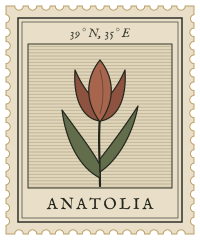
  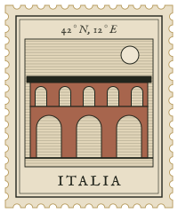
  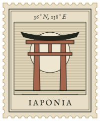
  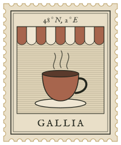
  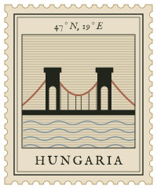
  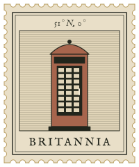

<i>Places to explore, ideas to build.</i>

<h2 align="center"></h2>

  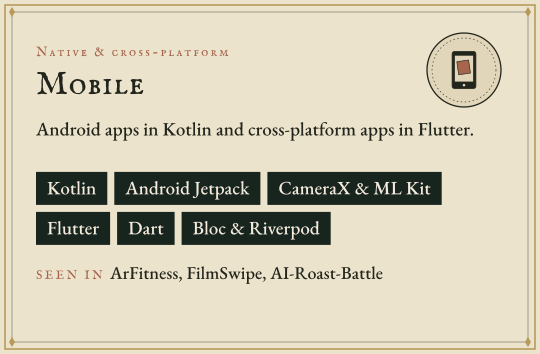
  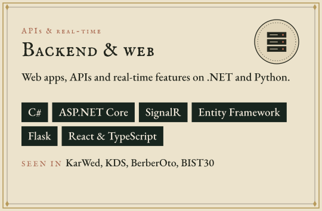

  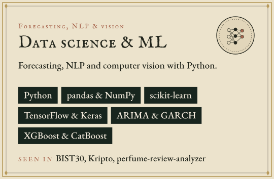
  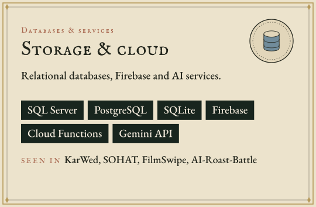

<h2 align="center"></h2>

<h3 align="center">Pinned on GitHub</h3>

  <a href="https://github.com/EnesKaraca44/bist30-portfoy-optimizasyonu">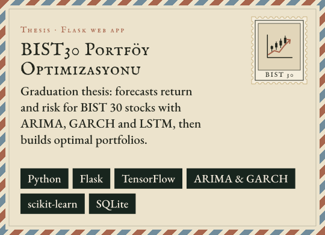</a>
  <a href="https://github.com/EnesKaraca44/ArFitness">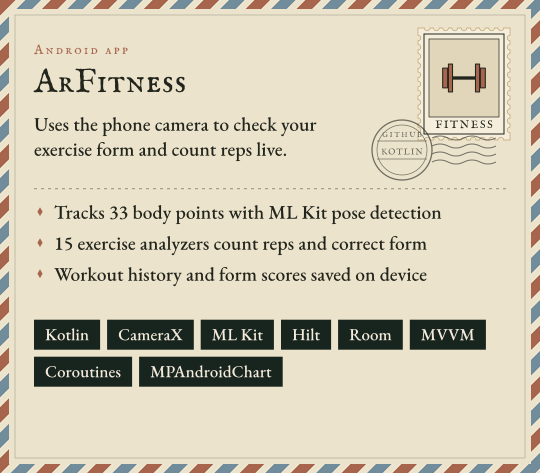</a>

  <a href="https://github.com/EnesKaraca44/Kds">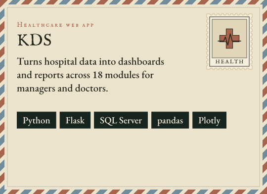</a>
  <a href="https://github.com/EnesKaraca44/perfume-review-analyzer">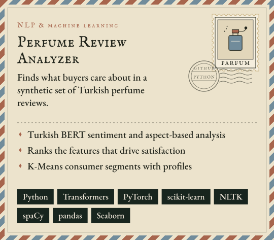</a>

<h3 align="center">More projects</h3>

  <a href="https://github.com/EnesKaraca44/AI-Roast-Battle">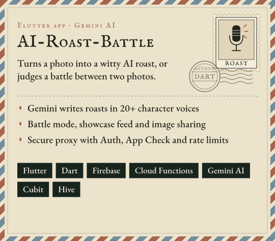</a>
  <a href="https://github.com/EnesKaraca44/FilmSwipe">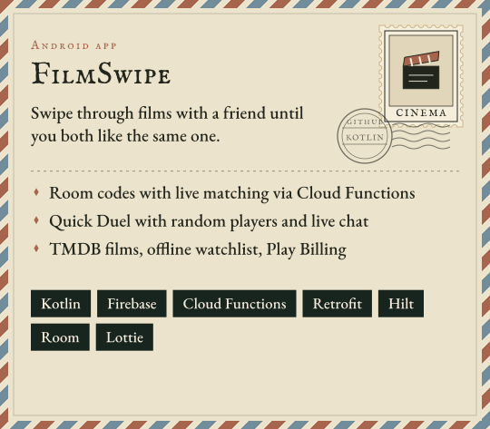</a>

  <a href="https://github.com/EnesKaraca44/KarWed">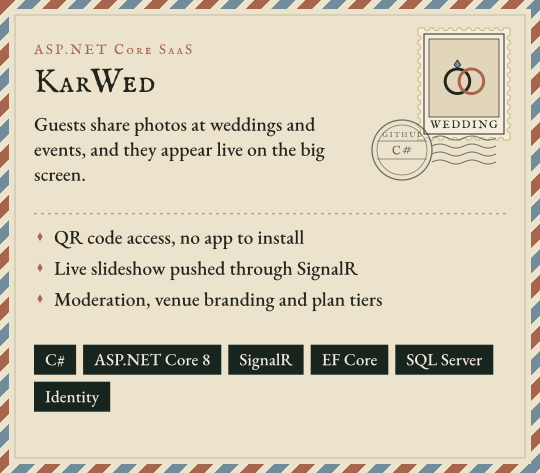</a>
  <a href="https://github.com/EnesKaraca44/-YIMA-Taahhut-ve-Insaat">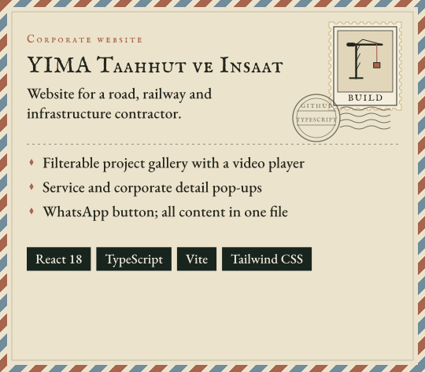</a>

<h2 align="center"></h2>

<h3 align="center">Web, backend and desktop</h3>

  <a href="https://github.com/EnesKaraca44/BerberOto">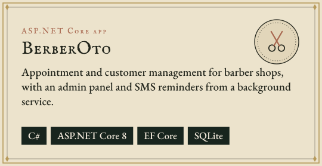</a>
  <a href="https://github.com/EnesKaraca44/SOHAT">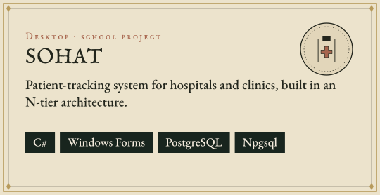</a>

  <a href="https://github.com/EnesKaraca44/MiniERP-StockManagement">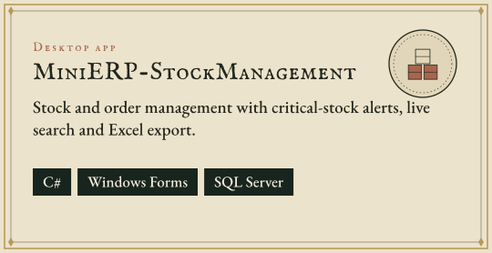</a>

<h3 align="center">Data and AI</h3>

  <a href="https://github.com/EnesKaraca44/Kripto">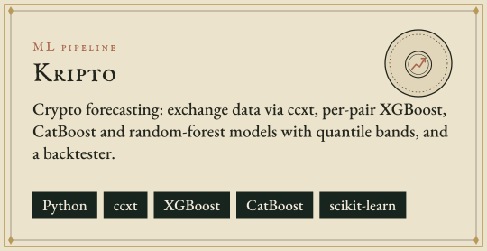</a>
  <a href="https://github.com/EnesKaraca44/GORHUK">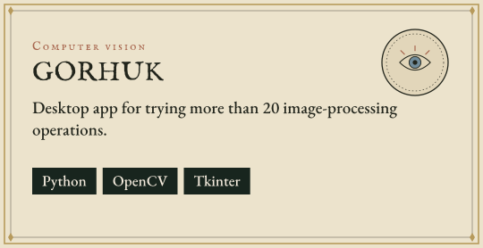</a>

  <a href="https://github.com/EnesKaraca44/Elite-AI-SDR-Squad">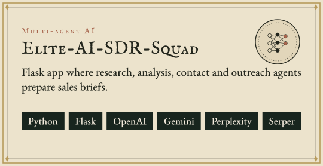</a>
  <a href="https://github.com/EnesKaraca44/B2B-Cold-Outreach-RevOps-Automation-Engine">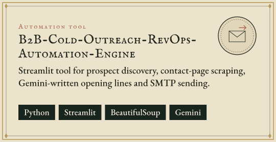</a>

<h3 align="center">Mobile</h3>

  <a href="https://github.com/EnesKaraca44/Zihin-Bahcesi">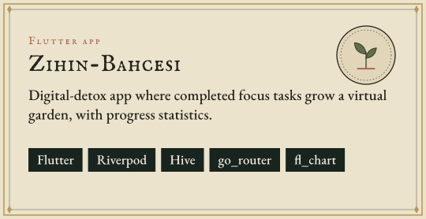</a>
  <a href="https://github.com/EnesKaraca44/Modern-butce-takip-uygulamasi">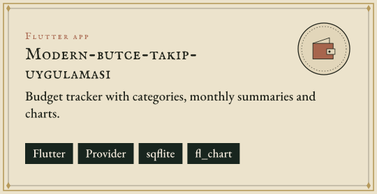</a>

<b>Early coursework</b> (Kotlin and Flutter practice projects)

 

- **[YemekSepeti](https://github.com/EnesKaraca44/YemekSepeti)**: Kotlin bootcamp capstone, a food-ordering app with a cart backed by a REST API.
- **[NeYesemApp](https://github.com/EnesKaraca44/NeYesemApp)**: a recipe browser with categories, recipe details and favourites.
- **[Filmler-Uygulama-Calismasi](https://github.com/EnesKaraca44/Filmler-Uygulama-Calismasi)**: a film catalogue exercise.
- **[DOVIZ-APP](https://github.com/EnesKaraca44/DOVIZ-APP)**: a Flutter currency converter.
- **[4.odev-sayfalar-arasi-gecis](https://github.com/EnesKaraca44/4.odev-sayfalar-arasi-gecis)**, **[APP-ANA-SAYFA-TASARIM-CALISMASI](https://github.com/EnesKaraca44/APP-ANA-SAYFA-TASARIM-CALISMASI)** and **[KotlinFonksiyonOdevi](https://github.com/EnesKaraca44/KotlinFonksiyonOdevi)**: bootcamp exercises on navigation, layout and Kotlin functions.

<a href="https://github.com/EnesKaraca44?tab=repositories">Browse every repository</a>

<h2 align="center"></h2>

  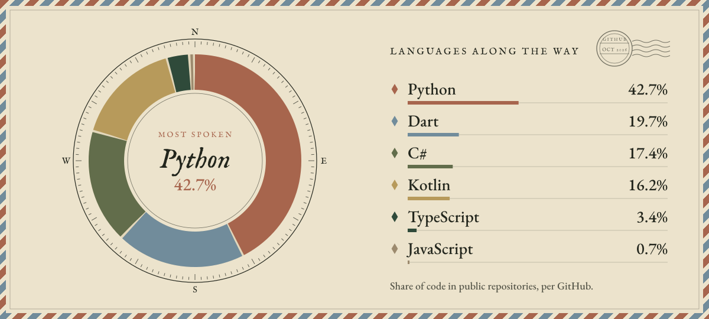

<h2 align="center"></h2>

  
  <a href="https://www.upwork.com/freelancers/~0143bae00c47e48a6a">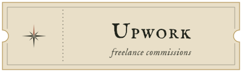</a>
  <a href="https://github.com/EnesKaraca44?tab=repositories">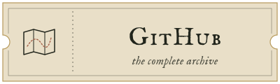</a>

  

  

