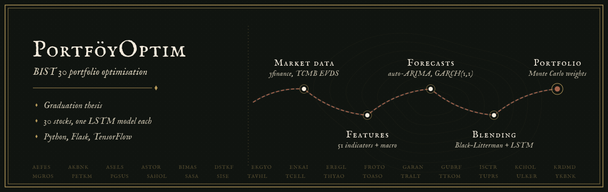
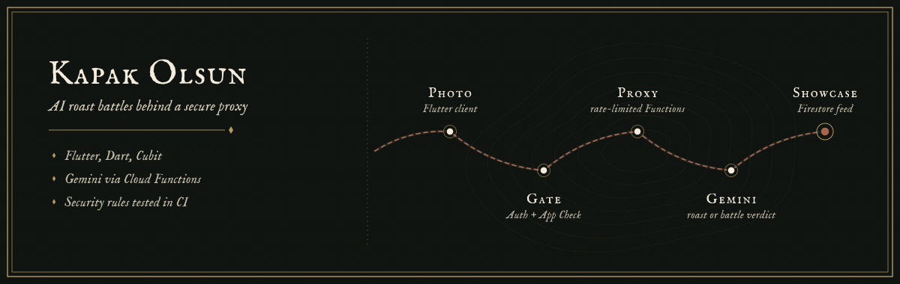

<!--
  The Art of Getting Lost: profile README for @EnesKaraca44.
  Every image in /assets is a self-contained SVG (lettering is outlined, no external fonts or images),
  so the page looks the same on every device. Animations respect prefers-reduced-motion.
-->

  

<h2 align="center"></h2>

I'm Enes, a developer from Türkiye working across three territories: native Android and Flutter apps, backends in ASP.NET Core and Flask, and data science with machine learning. I learn the way travellers do, by heading somewhere unfamiliar and building my way through it. So far that has meant a phone camera that coaches workout form, a live photo wall for weddings, and a graduation thesis that forecasts and optimises BIST&nbsp;30 portfolios.

I take on freelance projects through [Upwork](https://www.upwork.com/freelancers/~0143bae00c47e48a6a), and I'm always glad to hear about a new route worth exploring.

  
  
  
  
  
  

<i>Places to explore, ideas to build.</i>

<h2 align="center"></h2>

  

<h2 align="center"></h2>

### [PortföyOptim: BIST 30 portfolio optimisation](https://github.com/EnesKaraca44/bist30-portfoy-optimizasyonu)

My graduation thesis: a Flask web application that estimates return and risk for every BIST&nbsp;30 stock and proposes portfolios for low, medium and high risk profiles. A batch pipeline combines auto-ARIMA forecasts (fed by 51 technical indicators and macro signals such as USD/TRY, Brent oil and the central bank policy rate), GARCH(1,1) volatility, Black–Litterman views and a per-stock LSTM ensemble, then Monte Carlo simulation searches for the portfolio weights. The interface compares classic Modern Portfolio Theory with the ML portfolio, tracks forecast accuracy and runs a weekly user-versus-AI leaderboard. The repository includes a unittest suite and a one-year backtest.

Built with Python, Flask, TensorFlow and Keras, pmdarima, arch, scikit-learn, Plotly and SQLite.

### [ArFitness: an on-device AI workout coach](https://github.com/EnesKaraca44/ArFitness)

An Android app that turns the phone camera into a form coach. CameraX frames go to ML Kit Pose Detection, a custom overlay draws the detected skeleton, and a dedicated analyzer for each of 15 exercises reads joint angles to count reps, track movement phases and flag common form mistakes. Squats and lunges are also matched against reference movements with dynamic time warping. Workouts, form scores and history are stored on the device with Room, and camera frames are processed locally rather than uploaded.

Built with Kotlin, MVVM, Hilt, CameraX, ML Kit Pose Detection, Room, Coroutines and Flow, and MPAndroidChart.

### [KarWed: a live photo wall for weddings and events](https://github.com/EnesKaraca44/KarWed)

Guests scan a QR code at their table and upload photos and messages from the browser, with no app to install. The host approves each post in a moderation queue, and approved posts appear on the venue's big-screen slideshow in real time through SignalR, while a second hub keeps the admin panel's pending count live. The platform also covers ASP.NET Core Identity with Google sign-in, plan tiers, venue branding and server-side image processing.

Built with C#, ASP.NET Core 8 MVC, SignalR, Entity Framework Core, SQL Server and ImageSharp.

### [Kapak Olsun (AI Roast Battle)](https://github.com/EnesKaraca44/AI-Roast-Battle)

A Flutter app that sends a photo to Google Gemini and returns a roast in the voice of a chosen character. Battle mode compares two photos and picks a winner, and a showcase feed lets people share and react to results. The Gemini key never ships with the app: every call goes through a Firebase Cloud Functions proxy that checks authentication and App Check tokens, validates the payload and enforces per-user rate limits stored in Firestore. Firestore and Storage security rules are tested against the emulator in CI, and the interface is localised in Turkish and English.

Built with Flutter, Dart, flutter_bloc (Cubit), get_it, Firebase (Auth, Firestore, Storage, Functions, App Check), the Gemini API and Hive.

<h2 align="center"></h2>

### Mobile

- **[FilmSwipe](https://github.com/EnesKaraca44/FilmSwipe)**: settles "what do we watch tonight?" Friends join a room with a code and swipe through TMDB films, and a Cloud Function declares a match when everyone likes the same title. Also has quick duels with random players, in-room chat and an offline watchlist. Kotlin, Hilt, Retrofit, Firebase Realtime Database, Room, Lottie
- **[Zihin Bahçesi](https://github.com/EnesKaraca44/Zihin-Bahcesi)**: a digital-detox app in which completed focus tasks grow a virtual garden, with progress statistics. Flutter, Riverpod, Hive, go_router, fl_chart
- **[Modern Bütçe Takip](https://github.com/EnesKaraca44/Modern-butce-takip-uygulamasi)**: a budget tracker with categories, monthly summaries and charts. Flutter, Provider, sqflite, fl_chart

### Backend, web and desktop

- **[Kds](https://github.com/EnesKaraca44/Kds)**: a decision-support system for healthcare institutions, with Flask dashboards over SQL Server covering clinic traffic, treatment groups, stock, revenue, referrals, radiology and more. Python, Flask, pyodbc, pandas, Plotly, Waitress
- **[BerberOto](https://github.com/EnesKaraca44/BerberOto)**: appointment and customer management for barber shops, with SMS reminders sent by a background service. C#, ASP.NET Core 8, Entity Framework Core, SQLite
- **[YİMA Taahhüt ve İnşaat](https://github.com/EnesKaraca44/-YIMA-Taahhut-ve-Insaat)**: a corporate website for a civil-engineering contractor, with a filterable project gallery and all copy kept in a single content file. React 18, TypeScript, Vite, Tailwind CSS
- **[SOHAT](https://github.com/EnesKaraca44/SOHAT)**: a patient-tracking desktop system built as a school project in an N-tier architecture. C#, Windows Forms, PostgreSQL
- **[MiniERP](https://github.com/EnesKaraca44/MiniERP-StockManagement)**: stock and order management with critical-stock alerts and Excel export. C#, Windows Forms, SQL Server

### Data and AI

- **[Kripto](https://github.com/EnesKaraca44/Kripto)**: a crypto forecasting pipeline that pulls exchange data through ccxt and trains per-pair XGBoost, CatBoost and random-forest models, including 10th and 90th percentile quantile models, with a backtester. Python, ccxt, XGBoost, CatBoost, scikit-learn
- **[Perfume Review Analyzer](https://github.com/EnesKaraca44/perfume-review-analyzer)**: an NLP study on a synthetic set of Turkish perfume reviews, covering Turkish BERT sentiment, aspect-based sentiment, feature-importance ranking and K-Means consumer segments. Python, Hugging Face Transformers, NLTK, scikit-learn
- **[GÖRHÜK](https://github.com/EnesKaraca44/GORHUK)**: a desktop playground for more than 20 image-processing operations. Python, OpenCV, Tkinter
- **[Elite AI SDR Squad](https://github.com/EnesKaraca44/Elite-AI-SDR-Squad)**: a Flask app in which research, analysis, contact and outreach agents prepare sales briefs. Python, Flask, OpenAI, Gemini, Perplexity, Serper
- **[B2B Cold Outreach Engine](https://github.com/EnesKaraca44/B2B-Cold-Outreach-RevOps-Automation-Engine)**: a Streamlit tool for prospect discovery, contact-page scraping, Gemini-written opening lines and SMTP sending. Python, Streamlit, BeautifulSoup, Gemini API

<b>Early coursework</b> (Kotlin and Flutter practice projects)

 

- **[YemekSepeti](https://github.com/EnesKaraca44/YemekSepeti)**: Kotlin bootcamp capstone, a food-ordering app with a cart backed by a REST API.
- **[NeYesemApp](https://github.com/EnesKaraca44/NeYesemApp)**: a recipe browser with categories, recipe details and favourites.
- **[Filmler-Uygulama-Calismasi](https://github.com/EnesKaraca44/Filmler-Uygulama-Calismasi)**: a film catalogue exercise.
- **[DOVIZ-APP](https://github.com/EnesKaraca44/DOVIZ-APP)**: a Flutter currency converter.
- **[4.odev-sayfalar-arasi-gecis](https://github.com/EnesKaraca44/4.odev-sayfalar-arasi-gecis)**, **[APP-ANA-SAYFA-TASARIM-CALISMASI](https://github.com/EnesKaraca44/APP-ANA-SAYFA-TASARIM-CALISMASI)** and **[KotlinFonksiyonOdevi](https://github.com/EnesKaraca44/KotlinFonksiyonOdevi)**: bootcamp exercises on navigation, layout and Kotlin functions.

<a href="https://github.com/EnesKaraca44?tab=repositories">Browse every repository</a>

<h2 align="center"></h2>

<!-- Live cards from github-readme-stats. Languages generated by Flutter's platform folders (C++, CMake, Swift, C, Objective-C) and markup (HTML, CSS) are hidden so the chart reflects hand-written code. -->

  
  

<h2 align="center"></h2>

  
  
  

  

  

