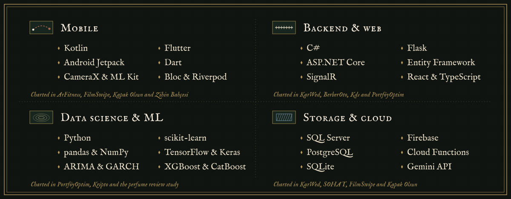
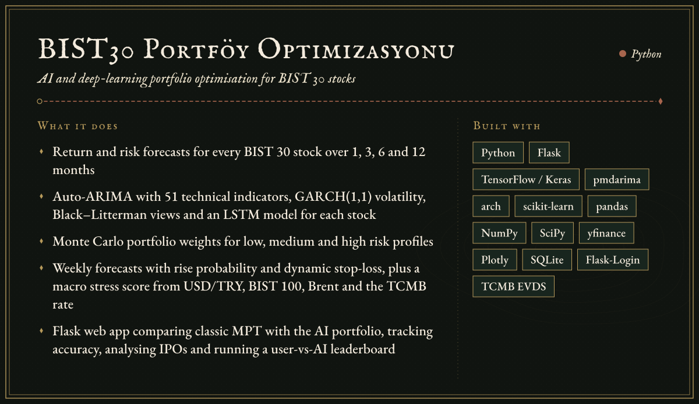
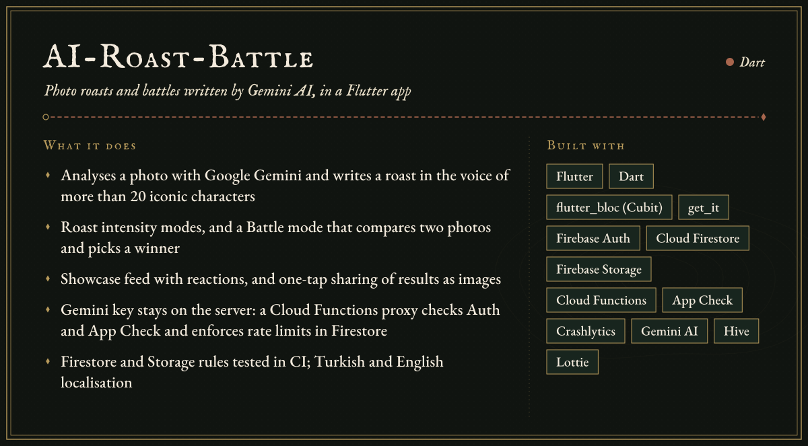
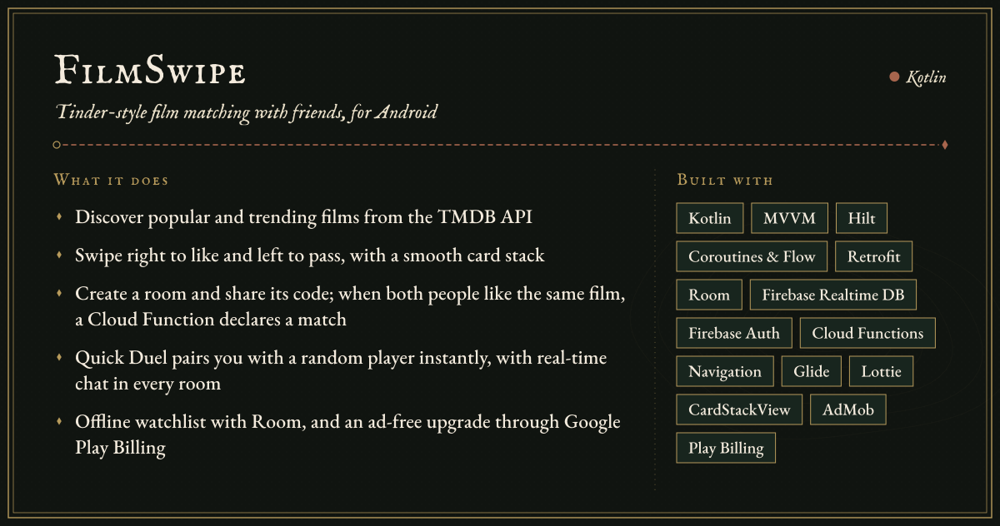
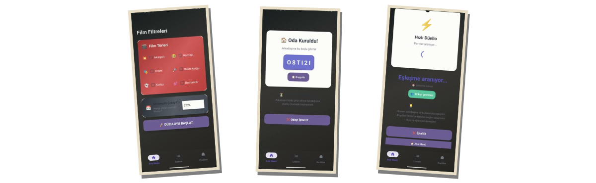
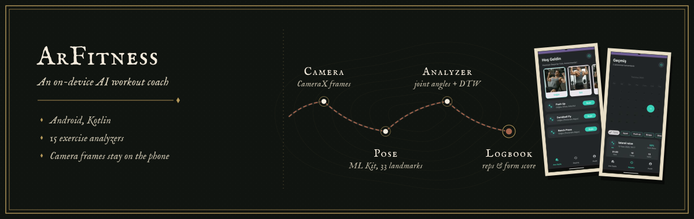
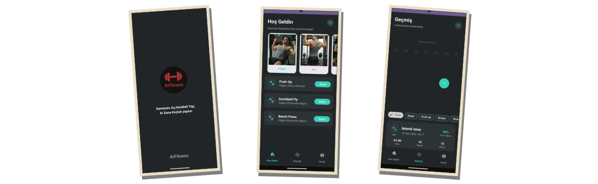
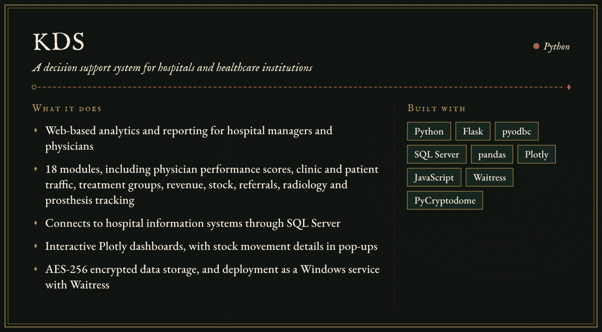
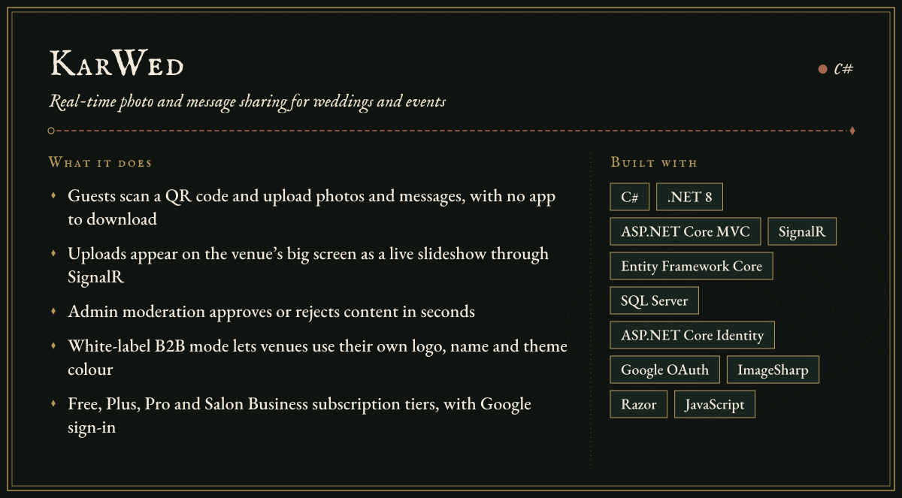

<!--
  The Art of Getting Lost: profile README for @EnesKaraca44.
  Every image in /assets is a self-contained SVG (lettering is outlined, no external fonts or images),
  so the page looks the same on every device. Animations respect prefers-reduced-motion.
-->

  

<h2 align="center"></h2>

I'm Enes, a developer from Türkiye working across three territories: native Android and Flutter apps, backends in ASP.NET Core and Flask, and data science with machine learning. I learn the way travellers do, by heading somewhere unfamiliar and building my way through it. So far that has meant a phone camera that coaches workout form, a live photo wall for weddings, and a graduation thesis that forecasts and optimises BIST&nbsp;30 portfolios.

I take on freelance projects through [Upwork](https://www.upwork.com/freelancers/~0143bae00c47e48a6a), and I'm always glad to hear about a new route worth exploring.

  
  
  
  
  
  

<i>Places to explore, ideas to build.</i>

<h2 align="center"></h2>

  

<h2 align="center"></h2>

### [bist30-portfoy-optimizasyonu](https://github.com/EnesKaraca44/bist30-portfoy-optimizasyonu)

My graduation thesis: a Flask application that combines classical portfolio theory with machine-learning forecasts for the stocks in Borsa İstanbul's BIST&nbsp;30 index.

### [AI-Roast-Battle](https://github.com/EnesKaraca44/AI-Roast-Battle)

A Flutter app that turns photos into AI-written roasts and battles, with the Gemini integration kept safely on the server.

### [FilmSwipe](https://github.com/EnesKaraca44/FilmSwipe)

An Android app that ends the "what should we watch tonight?" debate by letting friends swipe through films together until they match.

### [ArFitness](https://github.com/EnesKaraca44/ArFitness)

An Android app that uses the phone camera and on-device pose detection to coach exercise form in real time.

### [Kds](https://github.com/EnesKaraca44/Kds)

A Flask-based decision support system that turns hospital operational data into dashboards and reports for managers and physicians.

### [KarWed](https://github.com/EnesKaraca44/KarWed)

An ASP.NET Core SaaS platform that puts guests' photos and messages on the big screen at weddings and events, live.

<h2 align="center"></h2>

### Web, backend and desktop

- **[-YIMA-Taahhut-ve-Insaat](https://github.com/EnesKaraca44/-YIMA-Taahhut-ve-Insaat)**: the corporate website of YİMA Taahhüt ve İnşaat, a road, railway and infrastructure contractor. It has a filterable project gallery with a video player, service and corporate detail modals, a WhatsApp contact button, and all content managed from one TypeScript file. `React 18` `TypeScript` `Vite` `Tailwind CSS`
- **[BerberOto](https://github.com/EnesKaraca44/BerberOto)**: appointment and customer management for barber shops, with an admin panel and SMS reminders sent by a background service. `C#` `ASP.NET Core 8` `Entity Framework Core` `SQLite`
- **[SOHAT](https://github.com/EnesKaraca44/SOHAT)**: a patient-tracking system for hospitals and clinics, built as a school project in an N-tier architecture. `C#` `Windows Forms` `PostgreSQL` `Npgsql`
- **[MiniERP-StockManagement](https://github.com/EnesKaraca44/MiniERP-StockManagement)**: stock and order management with critical-stock alerts, live search and Excel export. `C#` `Windows Forms` `SQL Server`

### Data and AI

- **[Kripto](https://github.com/EnesKaraca44/Kripto)**: a crypto forecasting pipeline that pulls exchange data through ccxt and trains per-pair XGBoost, CatBoost and random-forest models, including 10th and 90th percentile quantile models, with a backtester. `Python` `ccxt` `XGBoost` `CatBoost` `scikit-learn`
- **[perfume-review-analyzer](https://github.com/EnesKaraca44/perfume-review-analyzer)**: an NLP study on a synthetic set of Turkish perfume reviews, with Turkish BERT sentiment, aspect-based sentiment, feature-importance ranking and K-Means consumer segments. `Python` `Transformers` `NLTK` `spaCy` `scikit-learn`
- **[GORHUK](https://github.com/EnesKaraca44/GORHUK)**: a desktop app for trying more than 20 image-processing operations. `Python` `OpenCV` `Tkinter`
- **[Elite-AI-SDR-Squad](https://github.com/EnesKaraca44/Elite-AI-SDR-Squad)**: a Flask app in which research, analysis, contact and outreach agents prepare sales briefs. `Python` `Flask` `OpenAI` `Gemini` `Perplexity` `Serper`
- **[B2B-Cold-Outreach-RevOps-Automation-Engine](https://github.com/EnesKaraca44/B2B-Cold-Outreach-RevOps-Automation-Engine)**: a Streamlit tool for prospect discovery, contact-page scraping, Gemini-written opening lines and SMTP sending. `Python` `Streamlit` `BeautifulSoup` `Gemini`

### Mobile

- **[Zihin-Bahcesi](https://github.com/EnesKaraca44/Zihin-Bahcesi)**: a digital-detox app in which completed focus tasks grow a virtual garden, with progress statistics. `Flutter` `Riverpod` `Hive` `go_router` `fl_chart`
- **[Modern-butce-takip-uygulamasi](https://github.com/EnesKaraca44/Modern-butce-takip-uygulamasi)**: a budget tracker with categories, monthly summaries and charts. `Flutter` `Provider` `sqflite` `fl_chart`

<b>Early coursework</b> (Kotlin and Flutter practice projects)

 

- **[YemekSepeti](https://github.com/EnesKaraca44/YemekSepeti)**: Kotlin bootcamp capstone, a food-ordering app with a cart backed by a REST API.
- **[NeYesemApp](https://github.com/EnesKaraca44/NeYesemApp)**: a recipe browser with categories, recipe details and favourites.
- **[Filmler-Uygulama-Calismasi](https://github.com/EnesKaraca44/Filmler-Uygulama-Calismasi)**: a film catalogue exercise.
- **[DOVIZ-APP](https://github.com/EnesKaraca44/DOVIZ-APP)**: a Flutter currency converter.
- **[4.odev-sayfalar-arasi-gecis](https://github.com/EnesKaraca44/4.odev-sayfalar-arasi-gecis)**, **[APP-ANA-SAYFA-TASARIM-CALISMASI](https://github.com/EnesKaraca44/APP-ANA-SAYFA-TASARIM-CALISMASI)** and **[KotlinFonksiyonOdevi](https://github.com/EnesKaraca44/KotlinFonksiyonOdevi)**: bootcamp exercises on navigation, layout and Kotlin functions.

<a href="https://github.com/EnesKaraca44?tab=repositories">Browse every repository</a>

<h2 align="center"></h2>

<!-- Live cards from github-readme-stats. Languages generated by Flutter's platform folders (C++, CMake, Swift, C, Objective-C) and markup (HTML, CSS) are hidden so the chart reflects hand-written code. -->

  
  

<h2 align="center"></h2>

  
  
  

  

  

